# Parental OpControl

[English](README.md) · [Español](README.es.md)

Self-hosted parental control for families: a web dashboard for parents, a Windows client for the child's computer and a guided installer. Ground-up rebuild of the ArktinMonitor parental control system, in English and Spanish.

**Current version: v0.17.29 · Beta.** Features may change before the stable release.

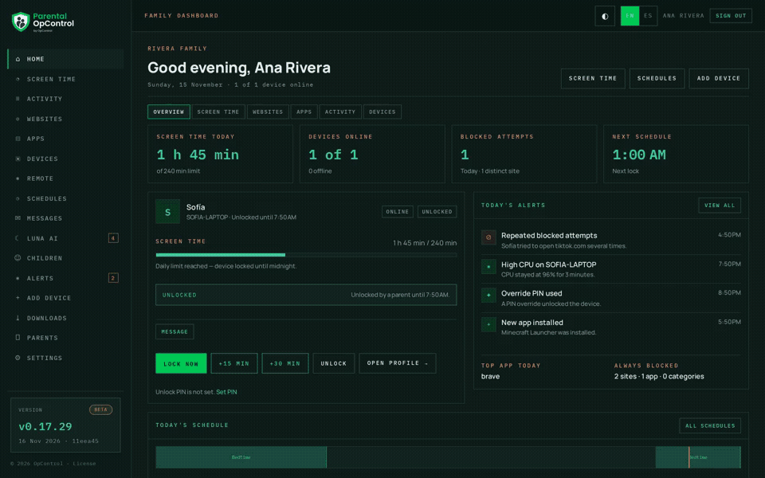

### Watch the full demo (5:45)

[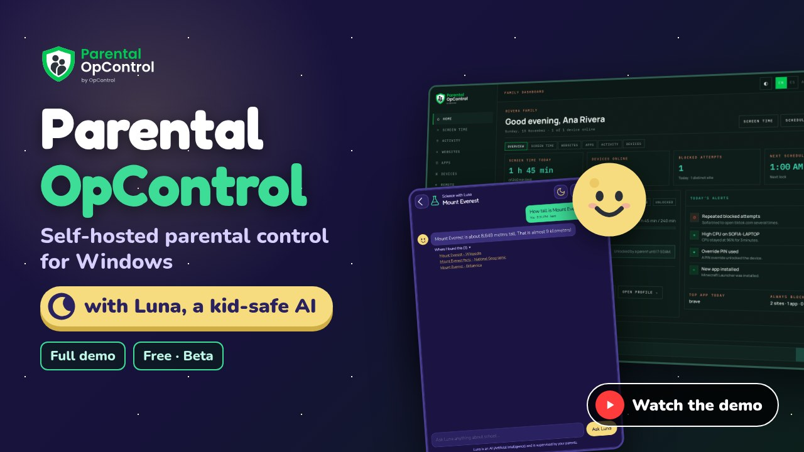](https://youtu.be/khIcOS5drO8)

The full walkthrough of the parent dashboard, the kid view and Luna AI is on YouTube: https://youtu.be/khIcOS5drO8

## For parents

| Family dashboard | Devices and live resources |
|---|---|
| 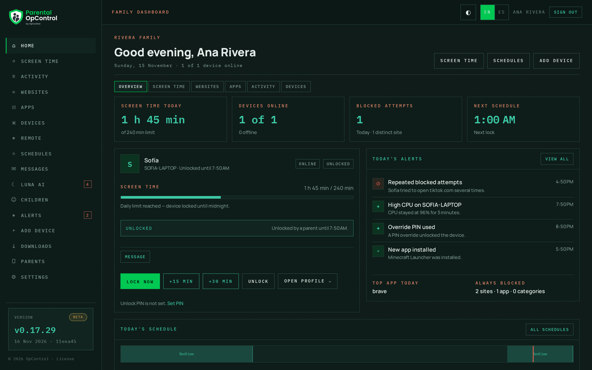 | 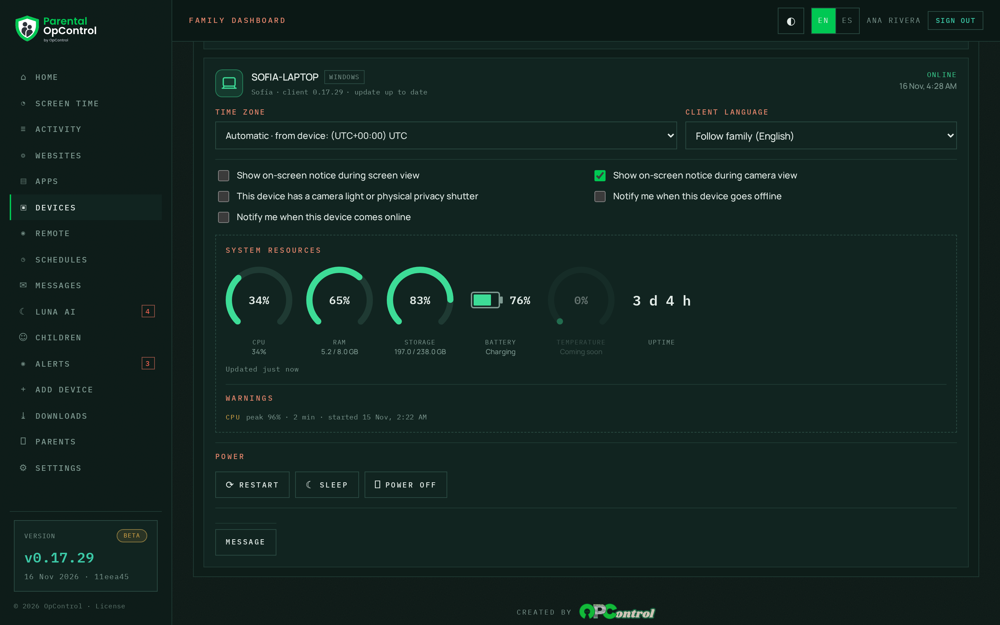 |

- One dashboard per family: online devices, screen time today, blocked attempts and the next lock.
- Lock, unlock and bonus time (+15, +30 or a custom amount) from the dashboard or the child's screen.
- Daily device limits and per-app limits, with day, week and month charts and an activity timeline.

| Rules and websites | Messages |
|---|---|
| 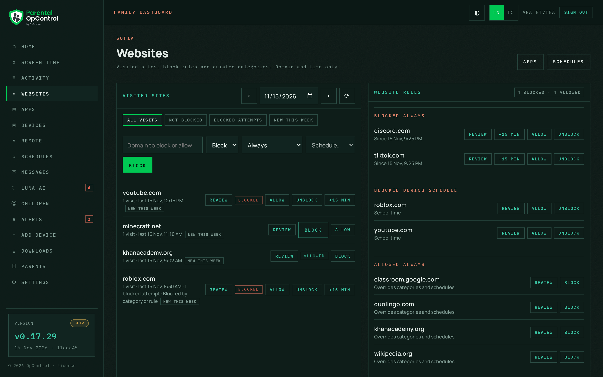 | 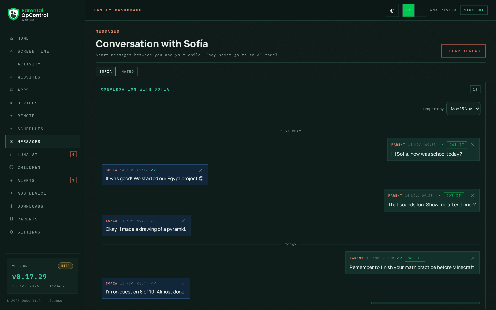 |

- Website filtering through a local DNS resolver, curated categories and per-site quick bonuses.
- Short parent–child messages with delivered, seen and acknowledged status, grouped by day.
- Remote screen and camera view (parent-initiated, up to 10 minutes, no audio, no recording).
- Alerts for tampering, limits and device warnings, plus bilingual email alerts and a daily digest.
- Co-parents with per-parent permissions, two-factor authentication and server administrator tools.

| Luna AI for a child | Luna review and safety |
|---|---|
| 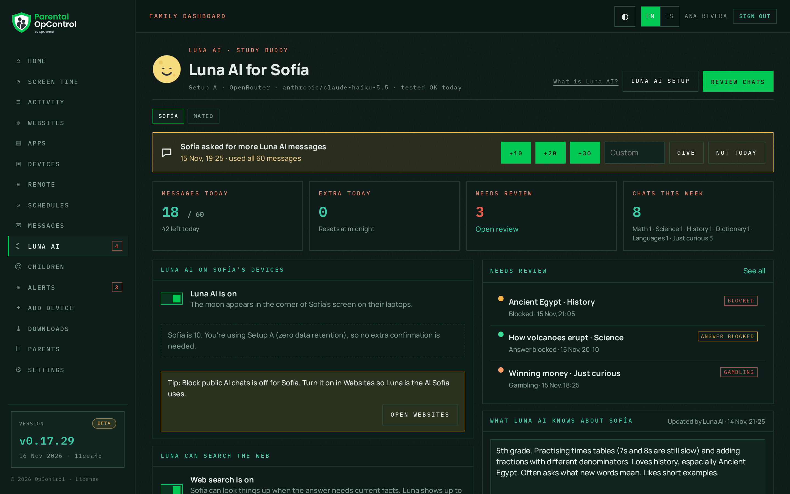 | 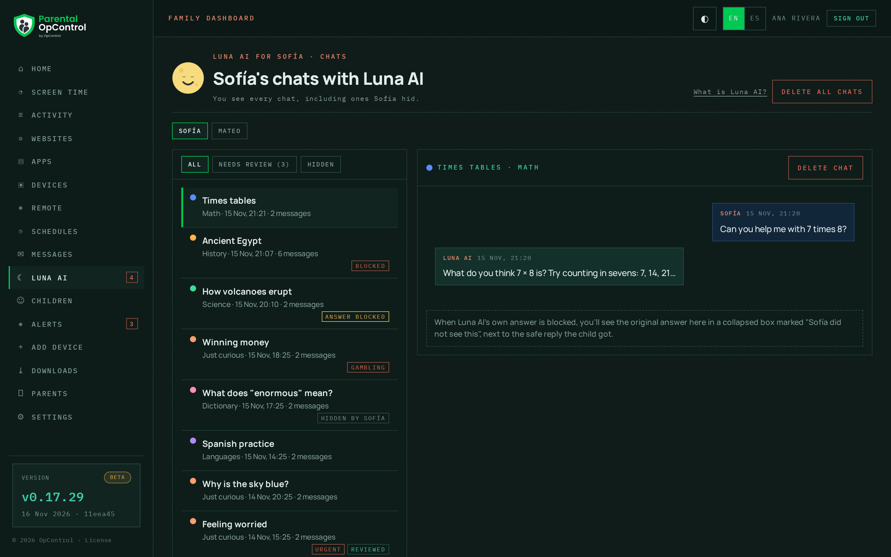 |

- Bring your own AI key. Every question and answer passes a safety filter before the child sees it.
- Parents can read every chat, see the web sources Luna used and review flagged topics.
- Daily message limits, quiet hours, zero data retention in Setup A and no account for the child.

| Light theme | Phone layout |
|---|---|
| 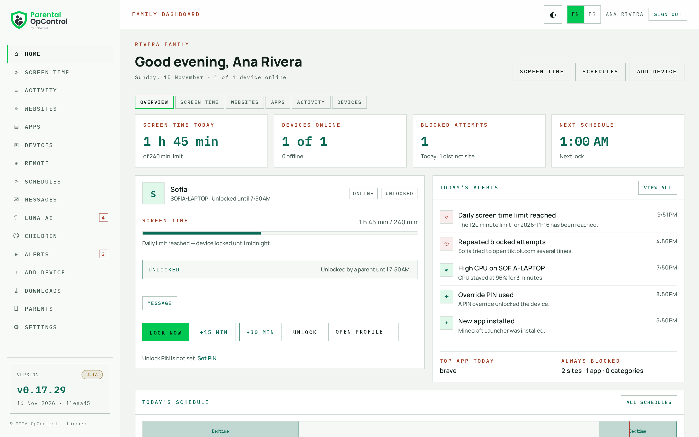 | 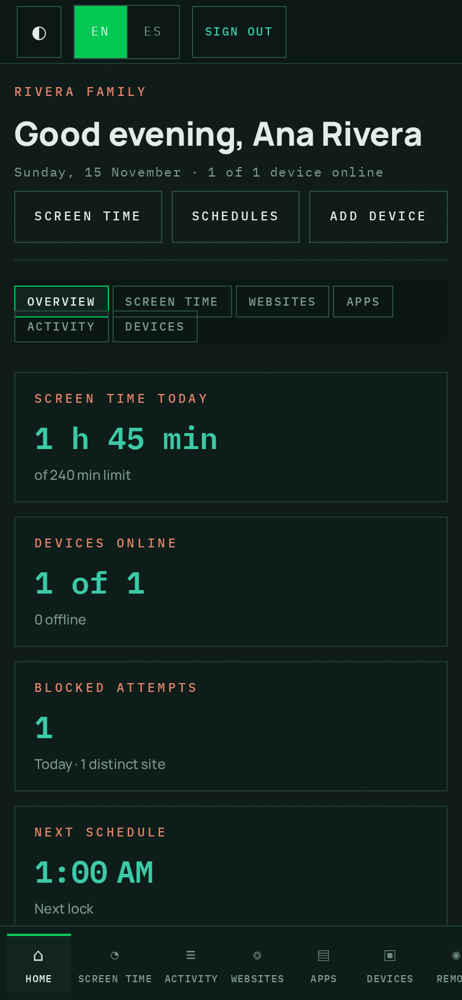 |

## For kids

| My OpControl | Moon gray theme |
|---|---|
| 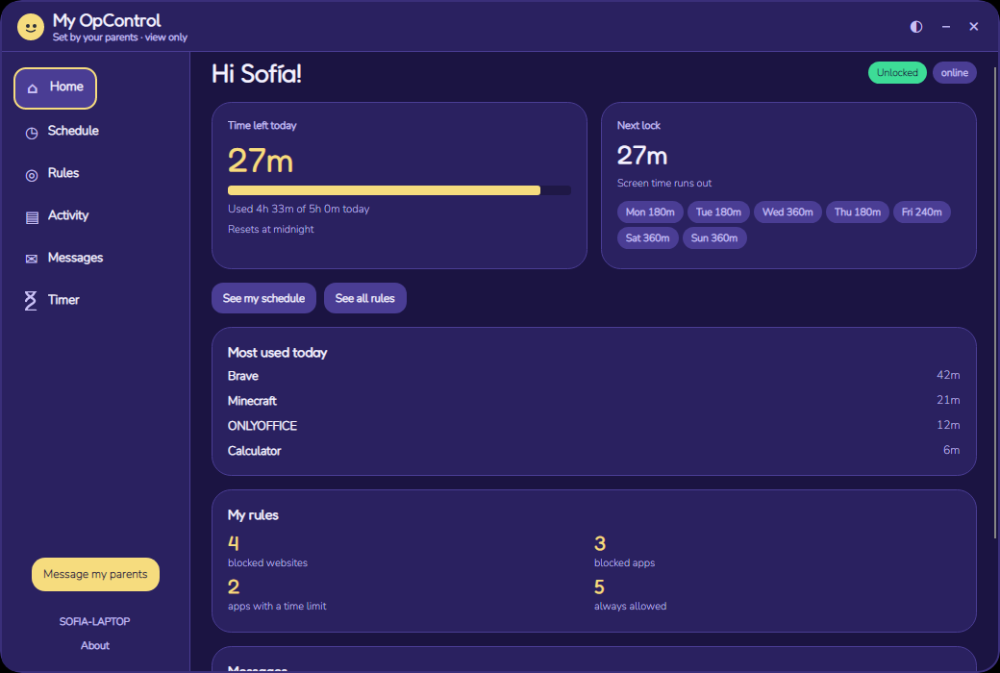 | 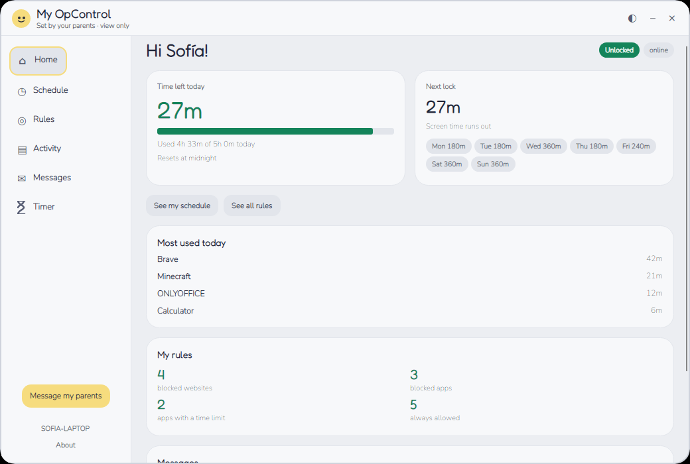 |

- My OpControl shows time left today, the next lock, most used apps and the family rules.
- A calm, night-sky design with a Moon gray alternative, in English and Spanish.
- Kids can message their parents from the window, the tray or the lock screen.

| Luna chat and sources | Luna searches the web |
|---|---|
| 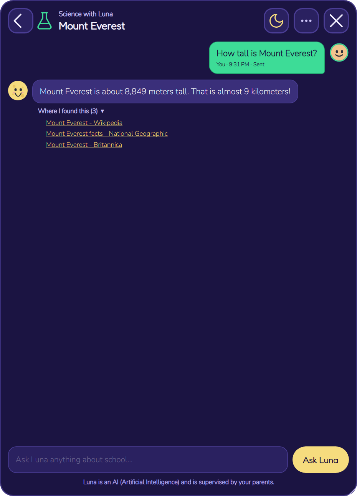 |  |

- Luna explains with short, age-appropriate answers and pictures, and can show “Where I found this”.
- The detective moon appears while Luna investigates on the web.
- Locks and schedules apply to Luna too.

## Coming soon: Play with Luna

Space Boards turn math practice into small games. Moon Tower, Orbit and Crater Clash are in design review.

| Moon Tower | Orbit |
|---|---|
| 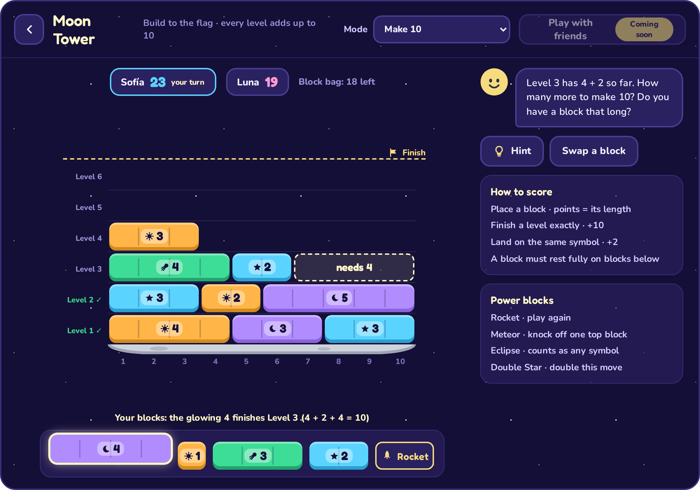 | 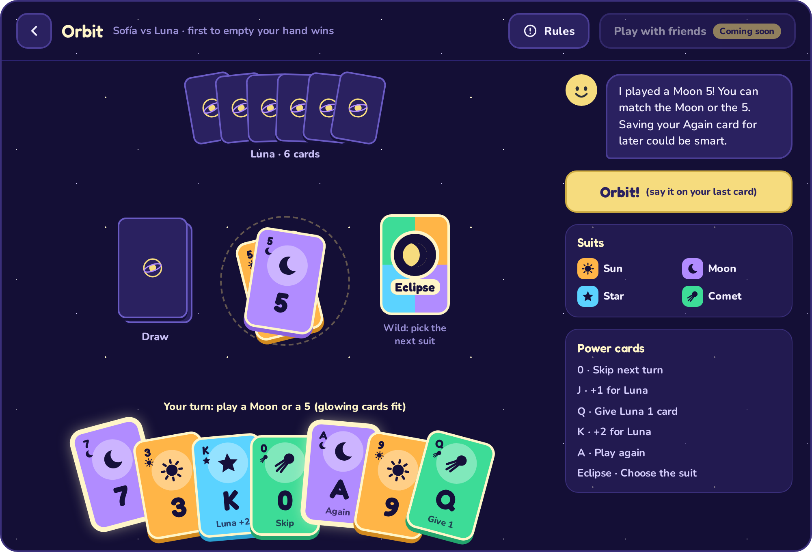 |

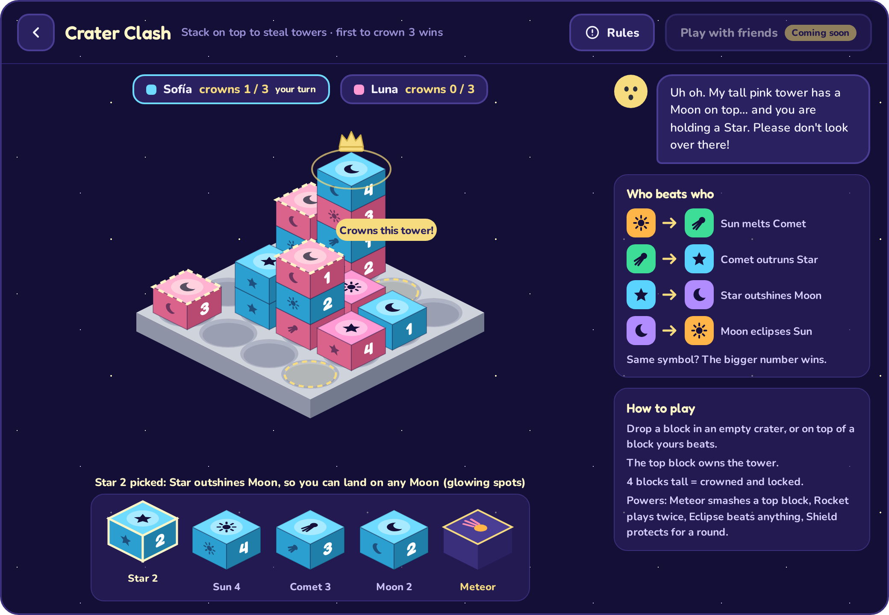

LunarCraft is planned next: **Critter Lab** (grow and care for moon critters), **Critter Arena** (friendly battles that practise math) and **Lunar Harvest** (a small farming loop). No images yet.

## Solution

| Project | Purpose |
|---|---|
| `src/OpControl.Parental.Server` | ASP.NET Core 10, Blazor Server dashboard, API, SignalR device hub, Identity, EF Core |
| `src/OpControl.Parental.Contracts` | Platform-neutral DTOs and hub method names |
| `src/OpControl.Parental.Client.Windows` | Windows service: enrollment, credential storage, SignalR, heartbeat, offline state cache |
| `src/OpControl.Parental.Client.Windows.Helper` | User-session helper: full-screen lock window driven by the cached state |
| `src/OpControl.Parental.Setup` | Setup bootstrapper (interactive install wizard that embeds the MSI) |
| `src/OpControl.Parental.Localization` | Shared English and Spanish strings for the Windows client and setup |
| `tests/OpControl.Parental.Tests` | Model, enrollment, credential and lock-evaluation tests |

Target framework: **.NET 10 (LTS), SDK 10.0.402, runtime 10.0.13**.

## Local build and test

```bash
dotnet restore
dotnet build
dotnet test
```

## Install on your own server

You need a Linux machine with Docker Engine and the Docker Compose plugin, a
domain name and HTTPS (a reverse proxy or tunnel in front of the web port).

1. Download `docker-compose.yml`, `.env.example` and `LICENSE` from the latest
   release: <https://github.com/ziur-vela/parental-opcontrol/releases>.
2. Put them in a folder such as `/opt/stacks/opcontrol-parental`.
3. Copy `.env.example` to `.env` and fill in:
   - `POSTGRES_PASSWORD`: a long random password.
   - `UPDATER_SECRET`: run `openssl rand -hex 32`.
   - `STACK_DIR`: the absolute path of this folder.
   - `PUBLIC_BASE_URL`: the address families will use, for example
     `https://parental.example.com`.
4. Start it: `docker compose up -d`.
5. Read the first-start setup token in the log:
   `docker compose logs web | grep 'FIRST-RUN SETUP'`.
6. Open `https://your-address/setup`, enter the token, create the first server
   administrator, scan the QR code with an authenticator app, and optionally add
   SMTP settings.
7. Add a child device from **Add device** and install the Windows client.

The setup page disappears after the first administrator is created. Later
families join by invitation from Server admin. The web container runs without
the Docker socket; only the updater sidecar has it.

## Updating

Server admin → **Updates** checks GitHub for stable releases every six hours.
When a new version is available, click **Update now** (with a two-factor code if
your account uses 2FA). The updater:

1. backs up the database with `pg_dump` (keeps the last five backups),
2. pulls the signed image by digest,
3. recreates the web container,
4. waits up to three minutes for `/health` to report the new version,
5. rolls back to the previous image if the health check fails.

Child devices update from their own server through the existing client update
flow. Pre-release tags are never offered on the stable channel. Installations
that must stay offline can turn the GitHub check off on the same page.

Our own homelab deployment notes, staging stack and build host steps are in
[`docs/HOMELAB-DEPLOY.md`](docs/HOMELAB-DEPLOY.md).

## Windows build host

Windows client builds run on a dedicated Windows build host, never on a monitored child device.
Everything is kept under `C:\BuildTools\opcontrol-parental`:

```powershell
# one-time setup (already done)
Invoke-WebRequest https://dot.net/v1/dotnet-install.ps1 -OutFile C:\BuildTools\opcontrol-parental\dotnet-install.ps1
& C:\BuildTools\opcontrol-parental\dotnet-install.ps1 -Version 10.0.402 -InstallDir C:\BuildTools\opcontrol-parental\dotnet -NoPath
& C:\BuildTools\opcontrol-parental\dotnet\dotnet.exe tool install wix --tool-path C:\BuildTools\opcontrol-parental\tools --version 5.0.2
& C:\BuildTools\opcontrol-parental\tools\wix.exe extension add -g WixToolset.Util.wixext/5.0.2
```

Build the client, helper, MSI and setup bootstrapper in one step:

```powershell
powershell -ExecutionPolicy Bypass -File C:\BuildTools\opcontrol-parental\repo\installer\build-windows.ps1 -Version 0.7.0
```

Artifacts land in `artifacts\OpControlParental-<version>.msi` and
`artifacts\OpControlParental-Setup-<version>.exe`. Do **not** build on a monitored child device.

## Windows client

Publish (Linux payload publish only; WiX still needs Windows):

```bash
dotnet publish src/OpControl.Parental.Client.Windows -c Release -r win-x64 -o out/client
dotnet publish src/OpControl.Parental.Client.Windows.Helper -c Release -r win-x64 -o out/helper
```

### Installer, silent install and auto-update

The Windows installer is a WiX MSI plus a small WinForms setup bootstrapper. Build commands:

```bash
# 1. Publish the Windows payloads on any OS with the .NET 10 SDK
dotnet publish src/OpControl.Parental.Client.Windows -c Release -r win-x64 -o artifacts/publish-0.5.0/client -p:Version=0.5.0
dotnet publish src/OpControl.Parental.Client.Windows.Helper -c Release -r win-x64 -o artifacts/publish-0.5.0/helper -p:Version=0.5.0

# 2. Build the MSI on Windows (WiX 5 is Windows-only)
dotnet tool install wix --tool-path C:\ocp-build\tools --version 5.0.2
powershell -ExecutionPolicy Bypass -File installer/build-msi-windows.ps1 `
  -Version 0.5.0 -PublishRoot artifacts/publish-0.5.0 `
  -OutFile artifacts/OpControlParental-0.5.0.msi -InstallerDir installer

# 3. Embed the MSI in the setup bootstrapper
dotnet publish src/OpControl.Parental.Setup -c Release -r win-x64 -o artifacts/setup-0.5.0 `
  -p:Version=0.5.0 -p:MsiPath="$PWD/artifacts/OpControlParental-0.5.0.msi"
cp artifacts/setup-0.5.0/OpControl.Parental.Setup.exe artifacts/OpControlParental-Setup-0.5.0.exe
```

`installer/build-installer.sh` publishes the payloads and documents this sequence, but WiX itself
must run on Windows. The setup bootstrapper is interactive; the MSI supports silent install:

```bat
msiexec /i OpControlParental.msi /qn SERVER=https://parental.opcontrol.net CODE=XXXXXXXXXX ACCOUNT=<child-windows-account>
OpControlParental-Setup-0.5.0.exe /S SERVER=https://parental.opcontrol.net CODE=XXXXXXXXXX ACCOUNT=<child-windows-account>
```

There is no default Windows account. Interactive setup lists non-administrator accounts first
and requires the parent to pick one; silent installs must pass `ACCOUNT=`. The pre-configured
download names the setup `OpControlParental-<CODE>.exe`; the bootstrapper reads
the one-time code from its own file name and pre-fills the dialog. The MSI writes `SERVER`, `CODE`
and `ACCOUNT` to `HKLM\Software\OpControl\Parental` on first install; the service consumes and
deletes those values on first start. Upgrades keep `C:\ProgramData\OpControlParental` (device
credential, cached state), so no re-enrollment is required.

The server serves auto-update files from `data/releases` (mounted at
`/var/lib/opcontrol-parental/releases`). Place `OpControlParental-<version>.msi` and
`OpControlParental-Setup-<version>.exe` there. The highest version with an MSI is current;
the server publishes its SHA-256. A device checks daily and whenever the dashboard requests an
update, downloads the MSI, verifies SHA-256, runs the update runner, and reports healthy. If the
new service does not write the health marker within five minutes, the runner uninstalls it with
`SUPPRESSDATA=1` and installs the previous version (keeping the credential). The dashboard shows
the client version per device and an Update now button.

Signing is optional. Set a certificate and run:

```powershell
powershell -ExecutionPolicy Bypass -File installer/sign.ps1 -CertificateThumbprint <thumbprint>
```

This signs and verifies the MSI and setup EXE with SHA-256 and a timestamp.

### Install links (Add device)

Parents create a single-use install link in Add device. The dashboard shows the link, QR code,
one-time code and copy/email buttons. The link is valid for 24 hours by default
(`FamilySettings.InstallLinkMinutes`, configurable in Settings), can be revoked, and flips to
"Connected" when the device enrolls. The public `/i/<token>` page detects phones (Android coming
soon) and offers the pre-configured setup on Windows. A manual code entry fallback remains in the
setup dialog and in the Downloads page instructions.

### Manual scripted install (legacy)

`deploy/install-legacy.ps1` and `deploy/uninstall-legacy.ps1` remain for reference, but new devices should
use the MSI/setup. The legacy installer now requires `-MonitoredAccount`; there is no default account.

The service stores the device credential in `C:\ProgramData\OpControlParental\private\device.json`
with an ACL that grants access to SYSTEM and Administrators only. The user-session helper reads
only `state.json` (Users read) and never sees the credential.

## Credits

Parental OpControl was designed, directed and tested by Ziur, and built with AI
assistance: design, planning and code review with **Claude** by Anthropic, and
code written with **OpenCode**, the open-source AI coding agent, using
**DeepSeek V4.1 Flash** by DeepSeek. Every change was reviewed and tested by a
person before release.

Created by Ziur · OpControl IT. Third-party components, fonts and data sources
are listed in [THIRD-PARTY-NOTICES.md](THIRD-PARTY-NOTICES.md).

## License

Parental OpControl is free for personal and other non-commercial use under the
[PolyForm Noncommercial License 1.0.0](LICENSE). You may use, change and share
it for non-commercial purposes, and you must keep the Required Notice:

`Required Notice: Copyright (c) 2026 Ziur / OpControl IT Solutions (https://opcontrol.net)`

Commercial use (selling it, offering it as a paid service, or using it inside a
business) needs written permission from OpControl IT Solutions. Contact
`hendry.ruiz@opcontrol.net`.

The project may move to an open-source license (AGPL-3.0) if it gets
contributors. By sending a contribution you agree that it may be distributed
under this license and under any future license chosen by the copyright holder,
including AGPL-3.0. See [CONTRIBUTING.md](CONTRIBUTING.md).

Third-party components, fonts and data sources are listed in
[THIRD-PARTY-NOTICES.md](THIRD-PARTY-NOTICES.md).

## Migration

Generate a migration:

```bash
dotnet ef migrations add <Name> --project src/OpControl.Parental.Server --startup-project src/OpControl.Parental.Server --output-dir Data/Migrations
```

The server applies pending migrations on startup.
